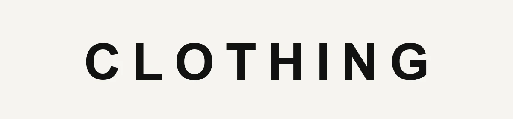

# Nike 3D Virtual Store

An interactive, hyper-realistic 3D Virtual Retail Store experience built with **React Three Fiber**, **Three.js**, and **Vite**.



---

## 🚀 Features

- **360° Interactive 3D Room**: Smooth camera orbit and mouse/touch navigation around a modern studio showroom with realistic reflections, metallic fixtures, and soft lighting.
- **4 Dedicated Station Showcases**:
  - **Clothing Rack**: Dynamic clothes rail with sliding hanger physics, natural fabric drape swings, and multi-angle product billboards.
  - **Caps Wall**: Birch pegboard display featuring baseball caps and bucket hats on individual metal brackets.
  - **Bags & Backpacks**: Oak shelving cubbies with duffels and backpacks, plus hanging crossbody bags on chrome pegs.
  - **Shoes Gallery**: Modern sneaker pedestals with custom procedural oak back panel and soft drop shadows.
- **Studio Overhead Lighting & Reflections**:
  - High-intensity dedicated spotlights for every station (`intensity: 13`).
  - Realistic ceiling light strips with soft floor mirror reflections using `@react-three/drei`'s `MeshReflectorMaterial`.
  - Khronos `NeutralToneMapping` for punchy, color-accurate product rendition.
- **Product Inspection Modal**:
  - 360° drag-to-rotate inspection of items with seamless multi-angle photo swaps.
  - Safe-zone dynamic camera framing ensuring products are never occluded by UI cards or thumbnail rails.
  - Multi-size selectors with out-of-stock indicators and shake animations.
- **Shopping Bag & Checkout Flow**:
  - Flying Bézier curve animation adding items to bag with sound/visual feedback.
  - Sliding cart drawer with real-time quantity modifiers, subtotals, and empty bag state.
- **100% Cross-Device Responsive**:
  - **Desktop**: Expansive viewport with floating glass product cards and quick keyboard shortcuts (`ESC`, `←`, `→`).
  - **Tablet**: Optimized dual-column layout with touch-drag and pinch-to-zoom support.
  - **Mobile**: Seamless bottom-sheet product drawers, horizontal thumbnail carousels, and intuitive touch gestures.

---

## 🛠️ Tech Stack

- **Framework**: [React 18](https://react.dev/)
- **3D Engine**: [Three.js](https://threejs.org/) + [@react-three/fiber](https://docs.pmnd.rs/react-three-fiber)
- **3D Helpers**: [@react-three/drei](https://github.com/pmndrs/drei)
- **Bundler**: [Vite](https://vitejs.dev/)
- **Styling**: Vanilla CSS with modern Backdrop Filter & Glassmorphism

---

## 📦 Getting Started

### Prerequisites
- Node.js (v18 or higher recommended)
- npm or pnpm

### Installation

1. Clone the repository:
   ```bash
   git clone https://github.com/mrkowsik/nike-3d-store.git
   cd nike-3d-store
   ```

2. Install dependencies:
   ```bash
   npm install
   ```

3. Start development server:
   ```bash
   npm run dev
   ```
   Open [http://localhost:5173](http://localhost:5173) in your browser.

4. Build for production:
   ```bash
   npm run build
   ```

---

## 📄 License
This project is open-source and created for portfolio and educational demonstration purposes.
